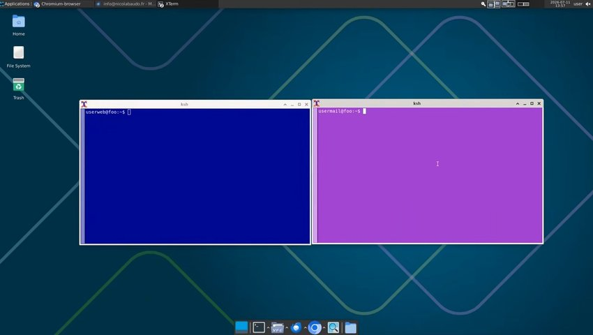

# dropQbsd

```
     __  +---+  __
       \_| Q |_/
         +---+
       dropQbsd
```

**Compartmentalization without virtualization -- on the BSD family.**

Qubes-style domain isolation using native Unix users, `pf`, and `ksh`. Web, mail,
and documents run as separate users with no shared access except a policed drop
zone. No hypervisor, no VM images, no daemon.

About 6,560 lines in total, comments and blank lines excluded
(counted -- see [Recount it](#recount-it)). One person who knows shell
can read all of it in a day -- and audit it, boundaries and all, in a few.

Runs on 1 GB of RAM. The installer takes under a minute -- give it fifteen,
because you should read the dry-run and set the passwords deliberately. The
updater takes seconds -- give it five, because the obsolete-files report is
worth reading. No databases to restore, no daemon state to rebuild.
Zero lock-in.


[](https://github.com/nobraininside/dropQbsd)
[](https://github.com/nobraininside/dropQbsd)
[](./LICENSE)
[](https://www.openbsd.org/)
[](https://www.freebsd.org/)
[](https://tangled.org/nobraininside.tngl.sh/dropQbsd)
[](https://github.com/nobraininside/dropQbsd)
[](https://git.sr.ht/~nobraininside/dropQbsd)

---

## Demo

[](https://gnulinux.tube/w/aymeWDMEZMbk2YQMqnMm93)

Three commands. Three habits. About fifteen minutes. Done.

---

## What is this?

Take the core insight of Qubes OS -- security through compartmentalization -- and
strip away the hypervisor. **dropQbsd** uses native BSD user separation instead
of heavy virtualization.

Each domain -- web, mail, documents -- runs as a dedicated user. They share
nothing except a single policed exchange directory. A handful of `ksh` scripts,
a declarative firewall policy, and standard Unix permissions do the rest.

No multi-gigabyte VM images. No Xen. No moving parts you can't audit in an
afternoon.

---

## What dropQbsd does NOT protect against

Read this before the architecture. If your threat model requires any of the
following, dropQbsd is not the right tool today -- **Qubes OS is**.

- **X11 input isolation.** X11 shares a single cookie (MIT-MAGIC-COOKIE-1)
  across all clients on a display. A compromised domain can keylog other
  domains, capture screenshots, and read the clipboard. This is a fundamental
  X11 limitation, not a dropQbsd bug. Mitigations in place -- disposable
  sessions, per-session cookies, XTEST disabled where possible -- reduce the
  exposure window. They do not close it. **The paired desktop/server
  configuration (roadmap) resolves this.**
- **Conductor compromise.** The conductor account can launch apps in any domain
  via `run_app`. If the conductor is compromised, all domains are compromised.
  Keep `conductor` minimal: no untrusted binaries, inspect files before importing.
- **Kernel-level attacks.** All domains share one kernel. A kernel exploit in
  one domain compromises everything. This is the tradeoff for avoiding
  virtualization.
- **Application-level telemetry.** BSD ships with zero telemetry, but
  applications you install may phone home independently. Use `librewolf`,
  `ungoogled-chromium`, or `qutebrowser`.

dropQbsd targets the most common real-world failures -- malware, phishing,
cross-domain data leaks, silent policy violations. It does not target kernel
exploits or state-level adversaries. Those require virtualization or hardware
isolation.

---

## Prerequisites

- A fresh **OpenBSD 7.5+** (reference platform) or **FreeBSD 14.0+**
  installation.
- **1 GB RAM** minimum (2 GB recommended for daily use).
- Root access (`doas` or `su`).
- **Korn shell:**
  - OpenBSD: `/bin/ksh` (base system).
  - FreeBSD: `mksh` — `pkg install mksh`.
- **`doas`** (FreeBSD only; base on OpenBSD): `pkg install doas`, then
  create `/usr/local/etc/doas.conf` with `permit :wheel` (plus
  `permit nopass root` for the dropQbsd template).

**What is in the base system.** On OpenBSD, `ksh`, `doas`, `signify`,
`tmux`, `pf`, `xrandr`, `setxkbmap`, `xenodm` and the base window managers
(`cwm`, `fvwm`, `twm`) are part of the base install. On FreeBSD, the base has
`sh`, `pf` (as a kernel module), `pfctl`, `file`, `stat`, `sha256`, `tar`,
`head`, `grep`, `sed`, `awk`; `ksh`, `doas`, `signify`, `tmux`, `xrandr`,
`setxkbmap`, `xfce`, `lightdm`, `dbus`, `qutebrowser`, `Xdialog` and all of
X11 are packages.

### Graphical session

A window manager or desktop environment is not installed by default.
Set `[session] wm` in `/etc/dropQbsd/local.conf` to the WM/DE you actually
use: `startxfce4`, `mate-session`, `cwm`, `twm`, `i3`.

If you want XFCE:

- **OpenBSD** (`xenodm` is the default DM; `lightdm` is not required):
  ```sh
  pkg_add xfce xfce-extras
  rcctl enable messagebus
  rcctl start messagebus
  ```
- **FreeBSD**:
  ```sh
  pkg install -y xfce lightdm lightdm-gtk-greeter
  sysrc dbus_enable=YES
  sysrc lightdm_enable=YES
  service dbus start
  service lightdm start
  ```

Then set:

```ini
[session]
wm = startxfce4
```

`startxfce4` is the XFCE wrapper; it sets the environment before
`xfce4-session`. Do not hardcode it in `~/.xsession`.

On **OpenBSD/xenodm**, the installer's `~/.xsession` ends with:

```sh
exec /opt/dropQbsd/libexec/wrapper /opt/dropQbsd/libexec/session
```

Leave it as is; `libexec/session` reads `[session] wm`. Do not replace it
with `exec startxfce4`.

On **FreeBSD**, `~/.xsession` is never installed. Use `~/.xprofile` for
LightDM/SDDM and `~/.xinitrc` for `startx`.

### Optional packages

Install these **before** running the installer, if you want the
corresponding features. The installer installs no packages: it has
no network policy yet, and silently installing packages during a
security install is not acceptable. If you prefer to install them
**after**, or step by step, follow
[INSTALL_MANUAL.md](./INSTALL_MANUAL.md).

| Package | Platform | Enables | If missing |
|---|---|---|---|
| `doas` | FreeBSD (base on OpenBSD) | root access for the installer and documented commands | use `su`, or `pkg install doas` |
| `mksh` | FreeBSD (base on OpenBSD) | the Korn shell the wrapper runs | no dropQbsd script runs |
| `tmux` | FreeBSD (base on OpenBSD) | `Qfile` | `Qfile` does not work |
| `nnn` | both | `Qfile` | `Qfile` does not work |
| `dzen2`, `xdotool` | both | `Indicator` | `Indicator` does not work |
| `password-store`, `xbindkeys`, `xclip`, `yad` | both | `Qmenu`, `Qsite` | `Qmenu` and `Qsite` do not work |
| `Xdialog` | both (`xdialog` on FreeBSD) | `Qattach` | `Qattach` does not work |
| `signify` | FreeBSD (base on OpenBSD) | integrity verification | integrity not available |
| `syncthing` | both | LAN file sync for `userdoc` | `userdoc` loses sync |
| `xrandr` | FreeBSD (base on OpenBSD) | DPI pinned to 96 at session start | fonts too large on high-density panels |
| `setxkbmap` | both (FreeBSD package; OpenBSD base) | `[keyboard] layout` applied by `libexec/session` | keyboard layout not applied |
| `qutebrowser` (or `ungoogled-chromium` / `librewolf`) | both | `Qsite` browser | Qsite shows the no-browser popup |
| `xfce`, `xfce-extras` | both (optional) | graphical session, XFCE | use another WM/DE and set `[session] wm` |
| `lightdm`, `lightdm-gtk-greeter` | FreeBSD only (optional) | graphical login for XFCE | use SDDM, `startx`, or xenodm; OpenBSD uses xenodm |
| `dbus` / `messagebus` | FreeBSD (`dbus`), OpenBSD (`messagebus`) | XFCE/LightDM session bus | XFCE/LightDM may fail |
| `mc`, `xfe` | both (optional) | file managers | no GUI/dual-pane file manager |
| a window manager | FreeBSD (OpenBSD base: `cwm`, `fvwm`, `twm`) | graphical session | no graphical session |

`doas` and `mksh` are prerequisites, not optional features. The other
rows are optional: a missing package disables one command, not the
system. `Xdialog` is installed separately because it can block.
`qutebrowser` is one of three supported browsers; `ungoogled-chromium`
and `librewolf` are alternatives.

The package list in `installer/optional_packages_list` uses three columns:
`<platform> <package> [binary]`. On FreeBSD the package is probed with
`pkg info -q`; the binary column is the `command -v` fallback
(`password-store` provides `pass`, `xdialog` provides `Xdialog`).

On OpenBSD:

```sh
doas pkg_add mc xfe nnn dzen2 xdotool yad xbindkeys password-store xclip syncthing qutebrowser Xdialog
```

On FreeBSD, `doas` and `mksh` are packages, not base. Install them first
as root:

```sh
su -
pkg install doas mksh
cat > /usr/local/etc/doas.conf <<'EOF'
permit :wheel
permit nopass root
EOF
exit
```

Then:

```sh
doas pkg install -y mc xfe nnn tmux dzen2 xdotool yad xbindkeys password-store xclip syncthing xdialog xrandr setxkbmap qutebrowser
```

`signify` is optional: add it to the list only if you want integrity
verification (it is in base on OpenBSD). The canonical, per-feature table is
in INSTALL_MANUAL.md, Prerequisites; the blocks above are the one-liner.

**A pre-existing account that collides with the conductor name stops the
installer.** The conductor defaults to the account name `conductor`
(rename-proof: recognized by the `dropQbsd_conductor` GECOS marker, not by
name). If an account named `conductor` already exists on your system (for
example, your personal login), the installer **fails with a clear message**
rather than guessing or prompting. Set a different name and re-run:

```sh
CONDUCTOR_USER=myconductor doas ./install.sh
```

The GECOS marker stays `dropQbsd_conductor` regardless of the account name.
A conductor account must be empty: it only directs domains, it does not hold
data (data belongs in `userdoc`).

---

## Install

**In a hurry?** Start with **[QUICKSTART.md](./QUICKSTART.md)**.

For the full paths: **[INSTALL.md](./INSTALL.md)** for the
semi-automatic install, and **[INSTALL_MANUAL.md](./INSTALL_MANUAL.md)**
for the manual procedure.

From the repository's `installer/` directory, as root:

```sh
chmod +x install.sh
./install.sh --dry-run     # see the plan first
./install.sh
```

The installer is idempotent and non-destructive of **system configuration**: it
never writes `local.conf`, never overwrites operator-owned files, and never
replaces an existing signing key unless you answer **yes** to *Regenerate the
key pair?*. It **does** overwrite per-user configuration -- `~/.exrc`, `~/.config/mc/ini`,
`~/.config/mc/menu`, `~/.config/nnn/plugins/` and `~/.config/xfe/scripts/` --
each backed up first as `.bak.<timestamp>`. Four paths are treated differently:
the Xfe seeds (`~/.config/xfe/xferc`, `xfwrc`) are copied once and only if
absent, and `~/.gtkrc-2.0` plus the conductor's `~/.xbindkeysrc` are created if
absent and never overwritten. See INSTALL_MANUAL.md 10.1.

**Domain accounts are never merged.** Each of the four domain users
(`$CONDUCTOR_USER`, `userdoc`, `usermail`, `userweb`) is created with a dropQbsd
GECOS role marker. If the account already exists *with the correct marker*,
the installer reuses it (upgrade/re-install). If it exists *without the marker*
(a pre-existing personal account), the installer **refuses to proceed**.
See the Prerequisites warning above.

---

## Update

To update an existing installation to the version in the repository:

```sh
chmod +x update.sh
./update.sh --dry-run      # see the plan first
./update.sh
```

**After the install, `doas` no longer works for your login account.** The
installer replaces `doas.conf` with `permit nopass root`; re-add
`permit :wheel` from `/var/backups/dropQbsd_<ts>/` if you want it back.
Until then, run as root.

The updater:

- **Preserves** your configuration. `local.conf` is the only file the updater
  never writes at all. Others are protected differently: `~/.gtkrc-2.0`,
  `~/.xbindkeysrc` and the Xfe seeds are created once and never replaced; the
  session stubs are replaced only when their `# dropQbsd-stub` marker changes.
- **Replaces** project files only when their content changed.
- **Backs** up every file it overwrites, into a single versioned
  directory (`/var/backups/dropQbsd_update_<timestamp>/`), so any
  file can be restored with one cp.
- **Never regenerates the signing key.** If integrity is
  configured, it re-signs the manifest; the trust anchor is
  preserved.
- **Never deletes or renames anything.** Files no longer in the
  repository are reported, not removed.

**The updater verifies the GECOS markers.** Before touching anything,
it checks that every domain account carries its dropQbsd role marker.
If a marker is missing -- a foreign account, or a pre-marker installation
that was never migrated -- the updater refuses to run. On a pre-marker
system, run the migration once first (see INSTALL_MANUAL.md 1, "Marking
an existing dropQbsd system"), or re-run the installer.

It prints a report in three sections: **files overwritten**,
**files obsolete** (project files no longer in the repo -- usually
the old copy of a file that moved), and **files left alone** (your
files, untouched).
**Takes about 5 minutes.** The updater itself runs in seconds; most
of the time is reviewing the "files obsolete" section before
deleting anything by hand.

---

## Desktop Integration

The `examples/` tree provides ready-made configuration for the
per-domain working environment:

- **`mc` skins** -- the per-domain color scheme for Midnight Commander.
- **`nnn` plugins** -- the `;c` / `;m` / `;i` key bindings that call
  `qcp`, `qmv` and `qimport`. **Mandatory for `Qfile`.**
- **`vi` config** -- key bindings for `nvi`.
- **`qmenu`** -- the conductor menu. A single YAD window with colored domain
  headers, driven by the `[qmenu]` section of `local.conf`. Bound to **`Mod4+q`**
  via `xbindkeys` in the conductor's `~/.xbindkeysrc`.

**The installer installs this automatically** (the "Desktop
integration" step). For a manual install, see
[INSTALL_MANUAL.md](./INSTALL_MANUAL.md) 10.

The **independent utilities** -- control panel, domain indicator, site menu,
Syncthing, VLC (INSTALL_MANUAL.md 10.7-10.15) -- are **not** installed by the
installer. The conductor's `~/.xbindkeysrc` *is* seeded if absent, but the
`xbindkeys` package is yours to install.

### Knowing where you are

Compartmentalization only works if you can tell the compartments
apart. dropQbsd uses one consistent color per domain across every
surface -- terminals, `mc`, `xfe`, and the OSD indicator:

| Domain | Color | Hex |
| --- | --- | --- |
| `conductor` | black | `#000000` |
| `root` | darkred | `#8B0000` |
| `userweb` | darkblue | `#00008B` |
| `usermail` | darkorchid3 | `#9A32CD` |
| `userdoc` | darkgreen | `#006400` |

The color is not decoration: in a system where every window looks
alike, it is the fastest signal of which domain you are about to
type into.

The same colors drive the `qmenu` headers, so the conductor menu
announces the domain at a glance.

The per-domain color is also applied to GTK2 pickers: each domain home
gets a ~/.gtkrc-2.0 (installed from examples/apps/gtk/), so Xdialog
dialogs in Qattach show the domain color. The conductor (`conductor`) gets a
black theme. Root has no picker theme. The file is **operator-owned**:
it is installed only if absent and never overwritten by an update.

---

## Architecture

### The Four Domains

| User       | Role                                                   | Network                         |
| ---------- | ------------------------------------------------------ | ------------------------------- |
| `conductor` | Conductor -- orchestrates, imports/exports, administers. Rename-proof: recognized by the `dropQbsd_conductor` GECOS marker, not by name. In `wheel` for `su`, no `doas`. | None (no direct network access) |
| `userweb`  | Web browser -- isolated from mail and LAN               | HTTP/HTTPS only                 |
| `usermail` | Email client -- isolated from web                       | Mail servers only               |
| `userdoc`  | Documents, sync, LAN storage -- no direct internet      | LAN + Syncthing                 |

All belong to the `drop` group, which is the shared channel for
the drop zone. Home directories are `chmod 700`, owned by the
user's own group (not `drop`): a home is private to its owner.

Each domain is a dedicated user account carrying a dropQbsd GECOS role
marker (`dropQbsd_conductor`, `dropQbsd_userweb`, `dropQbsd_usermail`,
`dropQbsd_userdoc`). The marker identifies the role and lets the installer
and updater refuse to merge a foreign account into a role.

**The conductor is rename-proof.** The conductor account is identified by its
GECOS marker (`dropQbsd_conductor`), not by its name. The default name is
`conductor`; it can be changed via `CONDUCTOR_USER`. Installer, updater, and
runtime scripts resolve the account from the marker, so renaming is safe.

**Collision handling.** If an account named `conductor` already exists at
install time (a foreign personal account, without the marker), the installer
does not guess or prompt: it fails and asks you to set
`CONDUCTOR_USER=<name>` and re-run. On an upgrade the name is read from the
existing marker and is never asked.

### The Drop Zone (`/home/drop`)

The **only bridge** between domains. A shared directory with strict rules:

- `/home/drop` is `2770 root:drop` -- SGID forces the `drop` group on all files
- Files in transit: `440` (read-only for owner and group)
- Directories in transit: `570` (group can traverse)
- Export directories: SGID `2770`, owned by `root:drop`

No domain can modify files once placed. A cron job (`enforce_drop`) runs every
60 seconds, correcting permissions, quarantining violations, and cleaning
abandoned artifacts.

**Drop zone risk model.** The drop zone root and the export directories are
`2770` (write for the `drop` group), so any member of the group can remove
or replace files in transit. This is accepted by design: the members of
`drop` are the same operator in different compartments, and the real threat
is a compromised domain, not a hostile one. The mitigations are:

- **`qcp` copies, it does not move** -- the original stays in the sender's
  home, so a file removed from the drop zone is not lost (only its transit
  copy is).
- **Files in transit are `440`** -- their content cannot be modified in
  place. A compromised domain can delete and re-add a file, but cannot edit
  one it did not place.
- **Import is a deliberate, inspected act** -- inspect files before
  importing with `Qinspect` (or `Qprompt qinspect` from a launcher).
  A replaced file is only dangerous if imported without inspection.
- **`_quarantine` is `750 root:wheel`** -- the three domains cannot read,
 write or touch it. The conductor is in `wheel` (for `su -`) and can read it;
 treat a quarantined file as operator material either way.

A stricter model (staging directories `570`, exports written by root) is
planned -- see Roadmap. The current model trades that protection for
simplicity and daily-use convenience.

**Import workflow:**

1. `qmv` moves a file into `/home/drop` via an atomic staging directory.
2. `qcp` copies a file into `/home/drop` without deleting the original.
3. `qimport` copies the file out into `~/Downloads`.
4. `enforce_drop` removes abandoned files after 30 minutes.

**Lifecycle.** `enforce_drop` decides by the file's **mtime**, not by when
it arrived:

| State | What `enforce_drop` does |
|-------|--------------------------|
| mtime older than 30 minutes | deletes it (`abandoned`), whatever its mode or GID |
| younger, wrong GID (and not root-owned) | quarantines it, whatever its mode |
| younger, correct GID, wrong mode | fixes the mode (`440` file, `570` dir) |
| younger, correct GID and mode | leaves it alone |

A file with an old mtime is "old" the moment it lands: the first cycle
deletes it. `qcp` and `qmv` reset the timestamp for this reason; a manual
`mv` or `cp -p` preserves it, and the file is removed at the next cycle.

### The Conductor -- `run_app` Architecture

The conductor launches graphical apps inside any domain without switching users.
The mechanism is a three-file split designed to eliminate the attack surface of
privilege escalation:

| File                   | Type                          | Role                                                       |
| ---------------------- | ----------------------------- | ---------------------------------------------------------- |
| `bin/run_app`          | Compiled binary (setuid root) | Immutable gate -- 74 lines of C, no decision logic |
| `libexec/wrapper`      | `sh` script                   | Sanitizes the environment, selects the shell               |
| `libexec/run_app_impl` | `ksh`/`mksh` script           | All the logic -- domain selection, X11 cookie, tmpfs        |
| `src/run_app.c`        | C source                      | Reference only; needed only if the ABI breaks              |

**The gate.** `run_app` validates the argument count, escalates to root with
`setuid(0)`, and `execv`s the wrapper at a hardcoded path. It does not parse
arguments, does not branch on input, and does not decide which script to run.
All session logic -- domain selection, X11 cookie handling, tmpfs setup --
lives in `run_app_impl`, a plain script. Immutable after compilation: if you
need to add a domain, change paths, or adjust cleanup behavior, you edit the
script. No recompilation. 
The gate drops supplementary groups and sets gid 0 before uid 0, so
files created by root-owned scripts carry `wheel`, not the caller's
group.

**Two classes of action.** The gate recognizes two kinds of first argument:
a **domain** (`userweb`, `usermail`, `userdoc`) -- launch an app in that
domain -- or a **conductor action** listed in `/etc/dropQbsd/conductor.conf`
-- run a project script as root. Conductor actions are the gate's second
authority: they are declared in a signed file, so the set of root-runnable
scripts is auditable. Today there is one: `qattach`.

The gate is setuid root and therefore executable by every local user, so
**`run_app_impl` refuses any invoker that is not the conductor account** --
identified by the `dropQbsd_conductor` GECOS marker. Without that check a
compromised domain could launch applications in another domain, which is
the one crossing the compartment model exists to prevent. The gate captures
the caller's real uid with `getuid()` before `setuid(0)` and passes it as the first
argument; the wrapper clears the environment, so nothing else survives.

**The wrapper is the environment-sanitization and shell-selection layer.**
It runs with the privileges of its caller: root when invoked through `run_app`
(which is setuid root), the domain user when invoked from a domain, root when
invoked from cron. The wrapper sanitizes the environment before any script sees it:

- `PATH` is hardcoded to system directories. A user-controlled `PATH` in a root
  context is privilege escalation -- a fake `awk` earlier in `PATH` means
  arbitrary code as root.
- `IFS`, `LD_LIBRARY_PATH`, `LD_PRELOAD`, `PERL5LIB`, `PYTHONPATH`,
  `CDPATH`, `SHELL`, `HOME`, `LOGNAME`, `USER` are all unset.
- Only `DISPLAY`, `XAUTHORITY`, and `TERM` survive the crossing.
- The wrapper then selects the shell: `/bin/ksh` on OpenBSD, `mksh` on FreeBSD.

**`doas.conf` is one line:** `permit nopass root` -- at `/etc/doas.conf` on OpenBSD,
`/usr/local/etc/doas.conf` on FreeBSD. `$CONDUCTOR_USER` has no `doas` access at all.
The conductor is in `wheel`, so `Xtroot` can `su -` to root with the root password;
the gate is the only **passwordless** path to root. The gate can launch domain
applications, and it can run **conductor actions** -- project scripts declared
in a signed file (`conductor.conf`).. No conductor action is added silently:
the set is under `verify_integrity`.

**Two modes.** Normal mode creates an isolated runtime directory under `/tmp`,
cleaned on exit. Disposable mode mounts a tmpfs in RAM (500 MB default,
configurable) -- when the app exits, the tmpfs is unmounted and everything is
destroyed. Nothing survives. Ideal for browsers and untrusted files.

```
$ Run --disposable userweb qutebrowser --temp-basedir
$ Run --disposable 1G userweb ungoogled-chromium --temp-profile https://example.com
```

Downloads made in disposable mode are bridged to the real
`/home/$TARGET_USER/Downloads` via symlink -- files survive browser exit.

**Cleanup is guaranteed.** Traps on `EXIT`, `HUP`, `INT`, and `TERM` unmount
the tmpfs and remove the runtime directory. If the script is `SIGKILL`ed
(traps cannot catch it), a routine inside `run_app_impl` collects surviving
directories older than 24 hours at the next `run_app` invocation. Accumulation
is structurally impossible.

### Network Isolation

Network policy is **declarative and portable**. Two files describe your
security posture:

- `domains.conf` -- the portable policy. Identical on every installation.
  Describes intent, not syntax.
- `local.conf` -- your site configuration: subnet, mail servers, services.

`gen_fwall` translates this policy into `pf.conf` for the target OS.

**Firewall backup.** `gen_fwall` backs up the current `/etc/pf.conf` to
`/etc/pf.conf.bak.<timestamp>` before replacing it -- but only if the
current ruleset passes `pfctl -nf` (a corrupted ruleset is never preserved
as a restore point). The backup lives next to `pf.conf`, not in the
updater backup dir, because `pf.conf` is generated, not a project file:
a connection problem right after `Gen` is fixable with a single `cp`.

The policy is default-deny with explicit allowlists:

| Domain     | Role       | Network access                                                        |
| ---------- | ---------- | --------------------------------------------------------------------- |
| `conductor` | conductor  | None                                                                  |
| `userweb`  | browser    | Ports 80/443 to the internet, DNS. RFC 1918 and localhost blocked.    |
| `usermail` | mail       | Mail server ports only, DNS. Internet blocked.                        |
| `userdoc`  | documents  | LAN and Syncthing ports only, both directions. Internet blocked.      |

The policy file is short enough to read in full -- and that is the point. A
data protection officer with no networking background can verify what each
domain is permitted to reach.

**Portability note:** OpenBSD provides the `egress` interface group
automatically. FreeBSD does not -- `gen_fwall` resolves the physical interface
from `route get default`. This is the only portability gap between the two
`pf(4)` backends.

**NetBSD is not supported.** `npf(7)` filters by address and interface, not by
user. Per-user network isolation -- the foundation of dropQbsd's model -- cannot
be expressed in `npf`. `gen_fwall` refuses to generate a partial ruleset rather
than emit a firewall that silently drops per-user isolation.

### Domain Indicators

`indicator_de` shows an OSD popup when the active domain changes. It is
started from the session file -- `~/.xprofile` (SDDM/LightDM),
`~/.xsession` (xenodm), or `~/.xinitrc` (startx) -- in a detached
subshell that waits for the window manager to publish a real
`_NET_ACTIVE_WINDOW` before launching. A uid-keyed lock prevents a
double start when more than one session file is read.

Detection is a cascade:

1. Window title -- exact match for `$CONDUCTOR_USER`/`root`/`userweb`/`usermail`/`userdoc`
2. Window title containing `[root@` -- the shell prompt betrays root
3. `_NET_WM_PID` -- process owner via `ps`
4. `WM_CLASS` -- fallback for `xfe`/`Thunar`

Colors and their hex values: see *Knowing where you are*, under Desktop
Integration.

The indicator's lock lives in `${XDG_RUNTIME_DIR:-/tmp}`, keyed by uid.
It is deliberately **not** in `/var/run/`: the indicator runs as a domain
user, and `/var/run` is root-only, so a lock there would fail to be
created and the indicator would exit immediately on every start.

For tiling window managers (`i3`, `dwm`, `spectrwm`), the OSD indicator is not used.
The base window managers of the supported platforms -- `cwm` on OpenBSD, `twm` on
FreeBSD -- are also not suited to it: in these environments, domain differentiation
is provided by the color schemes of terminals, `mc`, and `xfe` launchers
(`examples/apps/mc/skins`, `xterm_*`).

Requires `dzen2`, `xdotool` and `xprop` (base X11).

Color per domain, and where each color appears: see *Knowing where you are*,
under Desktop Integration.

---

## Daily Usage

### Aliases

All commands are invoked through aliases defined in `/etc/dropQbsd/alias`,
loaded by the shell chain. The naming rule: **every alias starts with a
capital letter.** A single word when unambiguous; otherwise, the first
letters of the significant words, capitalized and joined.

| Alias           | Command                            |
| --------------- | ---------------------------------- |
| `Gen`           | `admin/gen_fwall`                  |
| `Patch`         | `admin/patch_tru_fwall`            |
| `Pkg`           | `admin/pkg_tru_fwall`              |
| `Sign`          | `admin/sign_filelist`              |
| `Update`        | `admin/update_tru_fwall`           |
| `Upgrade`       | `admin/upgrade_tru_fwall`          |
| `Run`           | `bin/run_app`                      |
| `Endrop`        | `libexec/enforce_drop`             |
| `Enhome`        | `libexec/enforce_home`             |
| `Ensync`        | `libexec/enforce_sync`             |
| `Enupdates`     | `libexec/ensure_updates_table`     |
| `Exmail`        | `libexec/export_mail_to_drop`      |
| `Exwww`         | `libexec/export_www_to_drop`       |
| `Immail`        | `libexec/import_mail_from_drop`    |
| `Imwww`         | `libexec/import_www_from_drop`     |
| `Indicator`     | `libexec/indicator_de`             |
| `Upmailserver`  | `libexec/update_mailserver_table`  |
| `Upservices`    | `libexec/update_services_table`    |
| `Verify`        | `libexec/verify_integrity`         |
| `Wrapper`       | `libexec/wrapper` (no args: prints usage) |
| `Qattach`       | `bin/run_app qattach userdoc`      |
| `Qcp`           | `sbin/qcp`                         |
| `Qcontrol`      | `sbin/qcontrol`                    |
| `Qfile`         | `sbin/qfile`                       |
| `Qimport`       | `sbin/qimport`                     |
| `Qinspect`      | `sbin/qinspect`                    |
| `Qmenu`         | `sbin/qmenu &`                     |
| `Qmv`           | `sbin/qmv`                         |
| `Qprompt`       | `sbin/qprompt`                     |
| `Qsite`         | `sbin/qsite &`                     |
| `Xtconductor`   | `sbin/xterm_conductor`             |
| `Xtroot`        | `sbin/xterm_root`                  |
| `Xtuserdoc`     | `sbin/xterm_userdoc`               |
| `Xtusermail`    | `sbin/xterm_usermail`              |
| `Xtuserweb`     | `sbin/xterm_userweb`               |
| ...             | see `/etc/dropQbsd/alias`          |

**Backgrounding.** `&` belongs in an alias only for a command that blocks
on a GUI dialog and must give the prompt back: `Qmenu` (`sbin/qmenu &`)
and `Qsite` (`sbin/qsite &`). Every `xterm_*` script detaches itself with
`nohup … &`, so backgrounding it again from the alias is redundant.
Commands that do real work in the foreground -- `Qcp`, `Qmv`, `Qimport`,
`Run`, `Gen`, `Sign`, `Verify` -- must not be backgrounded: you would lose
the exit status and the output.

### Moving Files Between Domains

Files move through `/home/drop`, the only bridge between domains.

**Copy a file into the drop zone (original stays in place):**

```
$ Qcp ~/document.pdf
```

**Move a file into the drop zone (original is deleted):**

```
$ Qmv ~/document.pdf
```

`qcp` and `qmv` apply correct permissions immediately, reset file timestamps to
prevent premature cleanup, verify the copy succeeded, and stage files
atomically.

**Import from the drop zone into ~/Downloads:**

```
$ Qimport document.pdf
$ Qimport folder1
$ Qimport document.pdf ~/Documents
```

`Qimport` handles directories directly.

### Attaching a File to a Mail or Upload (qattach)

`qattach` moves a file from a source domain into the Downloads of a
destination domain, so it can be attached to a mail or uploaded to a
website. It is a **GUI flow**, for the blocking case: you are composing
a mail or filling an upload form, and the file must arrive *now*.

```
$ Qattach
```

Three popups: pick a file (the picker runs as `userdoc`, the source
fixed by the alias, confined to its home -- other domains' homes,
mode 700, are invisible to it), then pick the destination, then
confirm the file landing in the destination's `~/Downloads`.
The file is staged in the drop zone, then imported.

The installer creates `~/Downloads` in every domain home. If the
directory is missing, `qattach` creates it before importing.

**Allowed directions** are declared in `/etc/dropQbsd/attach.conf`, one
`SRC:DST` per line:

```
userdoc:usermail
userdoc:userweb
```

The default matrix is deliberately minimal: **from the trusted source
(`userdoc`) toward the exposed domains** (mail, web). The reverse
directions carry untrusted data into the trusted archive and are handled
with `qcp` + `qimport`, not with a shortcut.

**Why not qattach everywhere?** `qcp` + `qimport` requires two
deliberate acts, which is itself a defense. `qattach` is reserved for
the blocking case, where two clicks are justified by urgency. Friction
proportional to urgency.

**Requirements:** `Xdialog` (`Xdialog` on OpenBSD, `xdialog` on FreeBSD).

### Conductor Menu (qmenu)

```
$ Qmenu
```

The conductor menu is a single YAD window listing the applications for
every domain, grouped under colored headers (conductor, root, userdoc,
usermail, userweb). The entries are defined in the `[qmenu]` section of
`local.conf`, in the format:

```
USERDOC
/path/to/cmd args | Display name
```

The display name may be several words but must not contain `--` or
`&` (both are interpreted as syntax by the entry's `eval`). See
INSTALL_MANUAL 10.4.

Header lines (`CONDUCTOR`, `ROOT`, `USERDOC`, `USERMAIL`, `USERWEB`) are not
selectable -- they only start a colored section. Display names must be
**unique across all domains**: they are used to resolve the command, so
`qmenu` warns and refuses to start on duplicates.

The menu is bound to **`Mod4+q`** via `xbindkeys` in the
conductor's `~/.xbindkeysrc` (operator-owned: installed once, never
overwritten).

**Requirements:** `yad`, `xbindkeys`.

### Interactive transfer via Qfile

```
$ Qfile
```

Four quadrants: `qcontrol` top-left, and `nnn` instances for `userdoc`
(green), `usermail` (orchid), `userweb` (blue). Press `;c` to copy, `;m` to
move, or `;i` to import the current item.

**Keys:**

| Key | Action |
| --- | ------ |
| `F1` | Jump to qcontrol |
| `F2` | Jump to userdoc |
| `F3` | Jump to usermail |
| `F4` | Jump to userweb |
| `F5` | Kill the session |
| `;c` | Copy the current item to /home/drop via qcp |
| `;m` | Move the current item to /home/drop via qmv |
| `;i` | Import the current item from /home/drop via qimport |

**Note on multi-selection:** nnn passes plugins the current item and the
containing directory. Copy, move, and import operate on **one item at a time**
-- the containing directory is never transferred. To process several files,
repeat the action for each, or use `qcp`/`qmv`/`qimport` directly from a
terminal with explicit paths.

**Note on F1-F5:** these bindings are global to the tmux server
(root key table), not scoped to the Qfile session. While
Qfile is running, F1-F5 are captured in every tmux session
on the machine. This is deliberate -- Qfile is meant to be
the only tmux session in use. If you run other tmux sessions,
their F1-F5 will be overridden until Qfile exits.

The status bar and active pane border follow the active domain. On exit,
Qfile terminates orphaned `nnn` processes gracefully (SIGTERM, then
SIGKILL for survivors).

### Launching Apps in Domains

```
$ Run --disposable userweb qutebrowser --temp-basedir
$ Run usermail claws-mail
$ Run userdoc xfe /home/userdoc
```

Browser flags for temporary profiles:

- Chromium / Ungoogled-chromium: `--temp-profile`
- Firefox: `--private-window`
- Librewolf: `--temp-profile --private-window`
- Qutebrowser: `--temp-basedir`

### Qcontrol

```
$ Qcontrol
```

An ncurses dashboard showing compartment status, drop zone contents, and system
health.

**What you see:**

- **Domains** -- which compartments are active and what process is running in each
- **Drop zone** -- files awaiting import (newer than 30 minutes), with the file/quarantine
  totals in the section header, plus permissions and quarantine status
- **System** -- PF state, load average, free space on /home, tmpfs usage, enforcement logs,
  integrity verification (requires root authentication)

**Keys:**

| Key | Action                                                              |
| --- | ------------------------------------------------------------------- |
| `q` | Quit                                                                |
| `a` | Authenticate as root (shows PF state, logs, integrity)              |
| `r` | Refresh root snapshot (re-authenticates)                            |

**Privilege model:** root data is time-boxed. The snapshot expires after 5
minutes, and every refresh re-authenticates. The snapshot is written by
`root_snapshot` (running as root) into `/var/run/dropQbsd/` with `root:drop
0640`; the owner is verified before the panel trusts it, and the lines are
sanitized (ESC stripped) before printing.

### Qsite

`qsite` is a two-phase launcher for password-protected sites. It
reads a list of sites from `~/.config/dropQbsd/sites.conf`, copies
credentials to the X11 clipboard via `pass(1)`, and opens the site in
a disposable browser session.

**Two-phase flow** (the point is to never paste a password into the
wrong site):

1. Select a site > **Copy ID** > the browser opens, the user ID is
   copied to the clipboard, and the window stays open.
2. The same site is now the only entry shown > **Copy Password** >
   the password is copied (with a 30-second clipboard clear timer),
   and the window closes.

Because phase 2 shows only the site that is waiting for the password,
there is no way to paste it into a different site.

The browser is chosen by fallback at runtime: **ungoogled-chromium**
first, then **librewolf**, then **qutebrowser** -- the first whose
binary exists is used, always with a disposable temporary profile
(`--temp-profile` / `--temp-basedir`).

**Configuration** -- `~/.config/dropQbsd/sites.conf`, one site per line:

```
# Label|URL|id_entry|pass_entry
Bank |https://bank.example.com|finance/bank_id|finance/bank_pw
ERP |https://erp.example.com|work/erp_id|work/erp_pw
# Sites without a separate ID field:
Forum|https://forum.example.com||web/forum
```

The `id_entry` and `pass_entry` are `pass(1)` paths. Store them with:

```
$ pass insert finance/bank_id
$ pass insert finance/bank_pw
```

**Launch:**

```
$ Qsite
```

**Requirements:** `yad`, `pass`, `xclip`, and a browser. See
INSTALL_MANUAL.md 10.13 for the setup.


### System Updates

System updates are performed through the scripts in `/opt/dropQbsd/admin/`, using the restrictive firewall.

Root has no general network access. The `<updates>` PF table is populated on
entry of each update script and flushed on exit (`FLUSH_ON_EXIT=1`), but the
`*/15` cron repopulates it -- so between updates the table is normally
populated, and empty only in the interval between an update finishing and the
next cron tick. Each update script prepends **temporary** DNS/HTTP rules for
root (`grant_dns`), removed when the operation finishes (`revoke_dns`),
restoring the strict ruleset. The `<updates>` egress rule is emitted by
`gen_fwall` and is not scoped to a user; see INSTALL_MANUAL.md section 8.
`<mailserver>` and `<services>` stay populated for daily use.


| Alias     | Purpose                                                    |
| --------- | ---------------------------------------------------------- |
| `Update`  | Full update: patches + firmware + packages + orphan cleanup |
| `Patch`   | Security patches only                                      |
| `Pkg`     | Install or update packages (`Pkg <name>` / `Pkg -u`)       |
| `Upgrade` | Major release upgrade (takes a `RELEASE` argument)         |

Each script refuses to start if another instance of the same tool is
already running, so two `pkg` processes cannot fight for the package
database lock.

**Release upgrades are multi-step on FreeBSD.** `Upgrade RELEASE`
automates the *sequence*, not the *moment*:

- **OpenBSD**: `sysupgrade` downloads the release set and reboots
  automatically.
- **FreeBSD (traditional base)**: `freebsd-update upgrade -r RELEASE`
  is phase 1 of 3. After rebooting, run `freebsd-update install`
  (repeat until it reports no more work), then `pkg upgrade -y`.
- **FreeBSD (PkgBase)**: `pkg upgrade -y -r RELEASE` prepares the
  upgrade. After rebooting, run `pkg upgrade -y` to sync the
  remaining packages.

When the upgrade is prepared but not finished, `Upgrade` leaves a
**pending-reboot marker** at `/var/log/dropQbsd/upgrade_pending`. The
login notice (from `/etc/dropQbsd/profile`) reads the marker and
reminds you that the upgrade is incomplete:

```
>>> dropQbsd: release upgrade PENDING -- the reboot has not
>>> been completed with the post-reboot install steps.
```

Remove the marker only after the post-reboot steps are done:

```sh
rm -f /var/log/dropQbsd/upgrade_pending
```

### Monitoring

**Logs** (one per script, named after the script). Every line is
`YYYY-MM-DD HH:MM:SS` followed by one space and the message -- no redundant
paths, no self-references. The format is shared by all scripts, so a panel
reading `tail -1` always sees the same shape:

```
$ tail /var/log/dropQbsd/enforce_drop.log
$ tail /var/log/dropQbsd/enforce_sync.log
$ tail /var/log/dropQbsd/verify_integrity.log
$ tail /var/log/dropQbsd/update_tru_fwall.log
```

Example:

```
2026-10-09 12:25:16 fixed: 1 file, 0 dir, 1 owner/group
```

**Check quarantine:**

```
$ ls -la /home/drop/_quarantine/
$ cat /home/drop/_quarantine/*.txt
```

**Live PF traffic:**

```
# tcpdump -n -e -ttt -i pflog0
```

**Integrity verification:**

```
$ Verify
```

**After updating scripts:** if you modify any monitored file,
`verify_integrity` will report a violation. This is expected. Re-sign the
manifest:

```sh
Sign
```

This includes the **configuration files** under `/etc/dropQbsd/`
(`conductor.conf`, `attach.conf`, `domains.conf`, `schema`, `filelist`):
they are monitored like the scripts. Adding a conductor action to
`conductor.conf` (see 10.9) or a direction to `attach.conf` requires a
re-sign before `verify_integrity` will pass.

**Testing the gate.** `run_app` is a compiled binary -- never run it with
`ksh -x` (it is not a script). To test a conductor action, use the alias
(`Qattach`) or the gate's full invocation. If `file /opt/dropQbsd/bin/run_app`
does not report a statically linked ELF, rebuild it with
`admin/build_run_app`.

---

## Scripts Reference

### Core Workflow

| Script              | Run by                | Purpose                                                        |
| ------------------- | --------------------- | -------------------------------------------------------------- |
| `qattach`           | conductor             | GUI: attach a file from a source domain into a destination's Downloads |
| `qcp`               | any user              | Copy file/directory into `/home/drop` without deleting         |
| `qfile`             | conductor             | 4-quadrant tmux bridge across all domains                      |
| `qimport`           | any user              | Copy from drop zone to `~/Downloads`                           |
| `qmv`               | any user              | Move file/directory into `/home/drop` via atomic staging       |
| `run_app`           | conductor (via `$CONDUCTOR_USER`, setuid root)   | Blind-gate binary. Escalates to root, execs `wrapper`          |
| `wrapper`           | root (via run_app)    | Sanitizes environment, selects the shell, execs the script     |
| `run_app_impl`      | root (via wrapper)    | Launch logic -- X11 cookie, runtime dir, tmpfs, `su -l`        |

### Launchers and Utilities

| Script            | Run by    | Purpose                                                              |
| ----------------- | --------- | -------------------------------------------------------------------- |
| `indicator_de`    | conductor | Domain indicator for XFCE/MATE via OSD popup                         |
| `qcontrol`        | conductor | ncurses dashboard -- domain status, drop zone, system health         |
| `qinspect`        | conductor | Inspect a drop-zone file before importing: metadata, type, hash, risk verdict |
| `qprompt`         | conductor | Run a dropQbsd command with a prompt loop, from a terminal or a launcher |
| `qsite`           | conductor | Two-phase site launcher with `pass(1)` integration                   |
| `root_snapshot`   | root (from `qcontrol`) | Privileged data for the control panel, time-boxed |
| `session`         | conductor | WM launcher; reads `[session] wm` from `local.conf` |
| `xterm_conductor` | conductor | Color-coded xterm for the conductor domain (black)                   |
| `xterm_root`      | conductor | Color-coded xterm, then `su -` to root (conductor in `wheel`; root password required)                   |
| `xterm_userdoc`   | conductor | Color-coded xterm for userdoc domain (darkgreen)                    |
| `xterm_usermail`  | conductor | Color-coded xterm for usermail domain (darkorchid3)                  |
| `xterm_userweb`   | conductor | Color-coded xterm for userweb domain (darkblue)                     |

`indicator_de` is started automatically from the session file
(`~/.xprofile`, `~/.xsession`, or `~/.xinitrc`) when the conductor
logs in. See "Domain Indicators" above.

### Installer and Updater

| Script       | Run by | Purpose                                                       |
| ------------ | ------ | ------------------------------------------------------------- |
| `install.sh` | root   | Semi-automatic installer (fresh install)                      |
| `update.sh`  | root   | Updater (existing installation, preserves config)             |

### Export/Import Pipeline

Run automatically by root's crontab on a schedule. Can also be run manually.

| Script                 | Domain   | Purpose                                                |
| ---------------------- | -------- | ------------------------------------------------------ |
| `export_www_to_drop`   | userweb  | Compress `~/www` into `userweb_export`, verify integrity |
| `export_mail_to_drop`  | usermail | Compress mail into `usermail_export`                   |
| `import_www_from_drop` | userdoc  | Import latest site archive, verify, keep 3 backups     |
| `import_mail_from_drop`| userdoc  | Import latest mail archive, keep 1 backup              |

Archives are published atomically: exporters write a `*.tar.gz.tmp` file and
rename it when complete. Importers only match `*.tar.gz`, so a partial archive
is never imported. If an export runs long, that slot's import exits 0 and the
next run imports the complete archive.

### Enforcement (cron, every minute)

| Script          | Run by | Purpose                                                                                             |
| --------------- | ------ | --------------------------------------------------------------------------------------------------- |
| `enforce_drop`  | root   | Fix permissions, quarantine violations, clean abandoned files. Logs to `/var/log/dropQbsd/enforce_drop.log`. |
| `enforce_home`  | root   | Fix owner/group/mode on the domain home directories and `/root`. |
| `enforce_sync`  | root   | Fix owner/group/permissions in Sync directory. Logs to `/var/log/dropQbsd/enforce_sync.log`.        |

### Firewall Table Management (cron)

| Script                    | Run by | Purpose                                                                                      |
| ------------------------- | ------ | -------------------------------------------------------------------------------------------- |
| `update_mailserver_table` | root   | Resolve mail server hostnames via userweb DNS, populate `<mailserver>` table from local.conf |
| `update_services_table`   | root   | Populate `<services>` table from local.conf                                                  |
| `ensure_updates_table`    | root   | Populate `<updates>` table with Fastly CDN blocks from local.conf                            |

### System Updates (root only)

| Script                | Run by | Purpose                                                                       |
| --------------------- | ------ | ----------------------------------------------------------------------------- |
| `patch_tru_fwall`     | root   | Apply security patches through restrictive PF                                |
| `pkg_tru_fwall`       | root   | Install/update packages through restrictive PF; repopulates `<updates>` after each `pfctl -f`  |
| `upgrade_tru_fwall`   | root   | Upgrade to next BSD release through restrictive PF (reboots)                 |
| `update_tru_fwall`    | root   | Full update: patch + firmware + pkg update + orphan cleanup                  |

**`<updates>` lifecycle.** Populated on entry of every update script and
flushed on exit (`FLUSH_ON_EXIT=1`), so it is normally populated between
updates; the `*/15` cron refills it. The full lifecycle, and the `<updates>`
egress rule that `gen_fwall` emits, are described in INSTALL_MANUAL.md
section 8. `<mailserver>` and `<services>` are never flushed -- they stay
populated for daily use.

### Integrity

| Script             | Run by      | Purpose                                                                                                          |
| ------------------ | ----------- | ---------------------------------------------------------------------------------------------------------------- |
| `sign_filelist`    | root (manual) | Sign the SHA256 manifest against the private key. Used after any change to a monitored file. |
| `verify_integrity` | root (cron)   | Verify monitored files against the signed manifest via `signify(1)`. Writes a single canonical line to `verify_integrity.log`; the raw `signify` output goes to `verify_integrity.log.detail`. |

The integrity keys are generated locally during setup, not distributed with the
repository. Each installation verifies its own scripts against its own
signature.

The integrity **filelist** (the files `verify_integrity` checks)
is verified for coherence during install and update: every file
the project ships must be listed, and every listed file must
exist. A shipped file missing from the list is a silent monitoring
gap, so the installer/updater stops in that case.

### Recovery

The entire system state is in a few places:

- **Scripts** in `/opt/dropQbsd/`
- **Users and groups** in `/etc/passwd`, `/etc/group`
- **Policy** in `/etc/dropQbsd/` (`domains.conf`, `local.conf`, `schema`,
  `attach.conf`, `conductor.conf`, `filelist`)
- **PF rules** generated in `/etc/pf.conf`
- **Cron jobs** in `/var/cron/tabs/root`
- **Firewall backup.** `gen_fwall` backs up the current `/etc/pf.conf` to
  `/etc/pf.conf.bak.<timestamp>` before replacing it -- but only if the
  current ruleset passes `pfctl -nf` (a corrupted ruleset is never preserved
  as a restore point). The backup lives next to `pf.conf`, not in the
  updater backup dir, because `pf.conf` is generated, not a project file:
  a connection problem right after `Gen` is fixable with a single `cp`.

**To rebuild from scratch:**

1. Install OpenBSD (or FreeBSD)
2. Copy the repository to the machine
3. Run the installer: `cd installer && ./install.sh`
4. Set passwords and edit `local.conf` (the installer prints the steps)

Typically under 15 minutes, often less. No databases to restore. No dropQbsd
daemon state to reconstruct.

---

## Portability

dropQbsd runs on OpenBSD and FreeBSD from a **single codebase**. No forks, no
per-OS patches, no duplicated scripts.

The mechanism is a runtime shell selector. `libexec/wrapper` detects the
operating system and executes the target script with the appropriate Korn Shell
variant:

| OS        | Shell                   | Notes                            |
| --------- | ----------------------- | -------------------------------- |
| OpenBSD   | `/bin/ksh`              | Base system (PD KSH)             |
| FreeBSD   | `/usr/local/bin/mksh`   | `mksh` must be installed         |
| NetBSD    | --                      | Not supported -- see below       |

Scripts in `sbin/` and `libexec/` carry **no shebang**. The wrapper decides.
Adding a new OS means extending one `case` statement -- not editing every script.

**Firewall backends** follow the same principle. `gen_fwall` reads a portable
policy (`domains.conf`) and a site configuration (`local.conf`), then emits
`pf.conf` for the target system.

The only portability gap between the OpenBSD and FreeBSD `pf(4)` backends is
interface detection: OpenBSD provides the `egress` interface group
automatically, while FreeBSD resolves the physical interface from
`route get default`.

**NetBSD is not supported.** `npf(7)` filters by address and interface, not by
user. Per-user network isolation cannot be expressed in `npf`. `gen_fwall`
refuses to generate a partial ruleset rather than emit a firewall that silently
drops per-user isolation.

---

## Philosophy

**dropQbsd** is not a distribution. It's a configuration. It doesn't fork the
BSDs -- it sits on top, using tools battle-tested for decades.

The goal is not to add layers of abstraction but to remove them. If Unix users
and permissions already provide isolation, why add a hypervisor? If `cron` and
`find` can police a shared directory, why run a daemon? If `ksh` and `pfctl`
can manage network access for updates, why build a package manager wrapper?
If a 74-line setuid C binary can gate privilege escalation, why give `conductor` a
`doas` ticket to the whole system?

**Complexity is the enemy of security.** dropQbsd keeps it simple, auditable,
and boring -- exactly what you want from a security tool.

### Recount it

Comments and blank lines excluded, in four parts:

- **~3,900** of shell -- what runs: `sbin/`, `libexec/`, `admin/`.
  Covered by the signed manifest that `verify_integrity` checks.
- **~2,100** for the `installer/` and `update.sh` tree -- what builds the
  system. Runs once, as root, before any firewall exists. Not copied to
  `/opt`, so not covered by the manifest: it is read, or it is trusted.
- **~490** of shell templates.
- **74** of C.

Total: about 6,560 lines.

Nothing up our sleeve -- the numbers are reproducible:

```sh
# shell: what runs
cat sbin/* libexec/* admin/* \
  | grep -v '^[[:space:]]*#' | grep -v '^[[:space:]]*$' | wc -l

# shell: what builds it
cat installer/install.sh installer/update.sh installer/lib/* \
  | grep -v '^[[:space:]]*#' | grep -v '^[[:space:]]*$' | wc -l

# shell templates
cat templates/* templates/rc.d/* \
  | grep -v '^[[:space:]]*#' | grep -v '^[[:space:]]*$' | wc -l

# C
wc -l src/run_app.c
```

One caveat, so the number means what it says: heredocs count. The
quarantine ticket in `enforce_drop` and the `--help` text in `install.sh`
are real lines of real files, and they are included.

---

## Roadmap

**Done:**

- ✅ Desktop standalone -- four domains, PF isolation, drop zone
- ✅ Disposable browser sessions (tmpfs-backed)
- ✅ Site menu with password manager integration (`qsite`)
- ✅ Archival pipeline (email + websites > userdoc)
- ✅ Declarative firewall policy (`gen_fwall`, `domains.conf` + `local.conf`)
- ✅ FreeBSD support (v0.3.0) -- same codebase, shebang selected by wrapper
- ✅ `qattach` -- GUI file attach between domains (Xdialog picker, v0.4.0)
- ✅ Semi-automatic installer (`install.sh`, v0.4.0)
- ✅ Updater (`update.sh`, v0.4.0) -- preserves config, replaces changed files

**Planned:**

- 📋 Stricter drop zone model -- staging directories `570` (so a compromised
  domain cannot remove or replace files in transit) and export directories
  written by root (`750 root:drop`) instead of by the exporting domain.
  See "Drop zone risk model".
- 📋 Ports tree submission (OpenBSD first, then FreeBSD)
- 📋 dropQbsd-paired + server (WireGuard client-server, input isolation)
- 📋 dropQlnx -- a separate Linux variant. Linux has no
  per-user packet filter (no `pf`, no `nftables` uid match), so
  the network isolation model must be rebuilt on cgroup v2 +
  nftables. A rewrite of the policy layer, not a port. Higher
  strategic value, but a large effort.

**Note on `dropQlnx`:** the name is deliberate. Linux is not a
port target like FreeBSD -- it is a different system with a
different isolation primitive. Calling it `dropQbsd on Linux`
would promise a portability that does not exist. `dropQlnx` is
its own thing: same philosophy, same user-separation model, a
rebuilt network layer.

**Note on NetBSD:** not supported, and not planned. `npf` has no
per-user filter, so the network isolation model cannot be
expressed on it. See "Network Isolation" above. This is a
limitation of `npf`, not a missing feature of dropQbsd.

---

## Design rationale

dropQbsd is the engineering expression of a longer argument about software,
verification, and accountability. Three articles lay out the reasoning:

- **[If you have an antivirus, you're probably in breach of GDPR](https://blog.nicolabaudo.fr/if-you-have-an-antivirus-you-re-probably-in-breach-of-gdpr/)** --
  Why endpoint security products are architecturally incompatible with GDPR
  accountability: root access, undocumented exfiltration, unverifiable claims.

- **[You cannot verify what you cannot see](https://blog.nicolabaudo.fr/you-cannot-verify-what-you-cannot-see-closed-source-privacy/)** --
  Why "privacy-respecting closed-source software" is a logical contradiction,
  and why audit theater cannot substitute for source access.

- **[Who are the real predators in cybersecurity?](https://blog.nicolabaudo.fr/who-are-the-real-predators-in-cybersecurity/)** --
  Risk as probability × severity, and why the dominant threat is not the
  hacker in the hoodie.

The full series -- *Embrace Philosophy or Let the Sophist Zombify* -- is at
[blog.nicolabaudo.fr/embrace-philosophy](https://blog.nicolabaudo.fr/embrace-philosophy/).

---

## GDPR and Privacy Professionals

If your organization processes personal data under GDPR, the architectural
argument for dropQbsd is developed in full in [GDPR.md](./GDPR.md): why
privacy by design (Art. 25) and staff training (Art. 39) are properties of
the system  rather than of the policy document -- which is not a substitute
for a training programme, but is the environment that gives it effect.

---

## License

ISC. See [LICENSE](./LICENSE).


